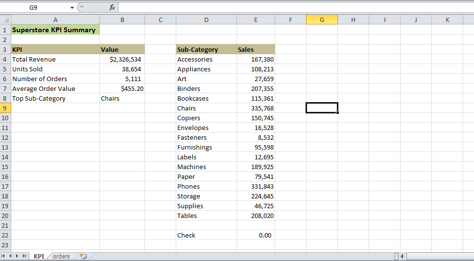
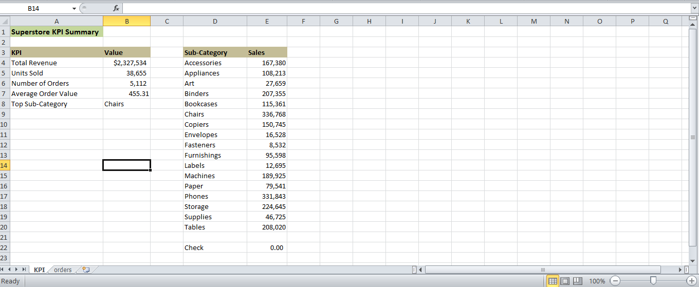

# Simple KPI Tracking Sheet (Excel)

## Overview
A one-page KPI summary that updates automatically from raw order data.
Built on the Sample Superstore dataset (10,194 order rows).

## Workbook structure
- orders: raw data, stored as an Excel Table named OrdersData
- KPI: a single summary sheet with 5 KPIs

## KPIs
1. Total Revenue: SUM of Sales
2. Units Sold: SUM of Quantity
3. Number of Orders: counts each Order ID once (helper column "Order Flag")
4. Average Order Value: Total Revenue / Number of Orders
5. Top Sub-Category: the sub-category with the highest sales
   (helper table using SUMIFS, then INDEX/MATCH)

## Current values
Total Revenue $2,326,534 | Units Sold 38,654 | Orders 5,111 |
Average Order Value $455.20 | Top Sub-Category: Chairs

## How it updates automatically
The data is an Excel Table and the formulas use the table name
(for example SUM(OrdersData[Sales])), so new rows are included without
editing any formula.

## Test
I added a test row (Sales 1,000, Quantity 1, Sub-Category Chairs) and the KPIs
updated: Revenue +1,000, Units +1, Orders +1, Chairs +1,000. I then removed the
test row and the original values returned (see test.png).

## Accuracy check
A check cell compares the sub-category totals with Total Revenue and shows 0.

## Tools Used
Microsoft Excel (Tables, SUMIFS, SUM, INDEX/MATCH)

## Dataset
Sample Superstore Dataset

## Screenshots

